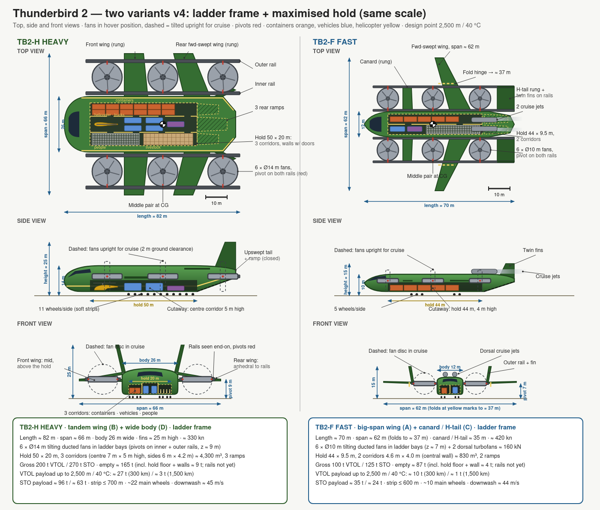

# tb2-derived

Designs derived from Thunderbird 2 (*Thunderbirds*, 1965), playing "what if" scenarios:
what would it take to make TB2 a physically plausible heavy-lift VTOL rescue transport?



## Where it stands
Two variants, sized with first-order models (rough numbers, not engineering data):

| | TB2-H Heavy | TB2-F Fast |
|---|---|---|
| Layout | Tandem wing + wide blended body | High-aspect folding wing + canard + H-tail |
| Lift | 6 × Ø14 m tilting ducted fans | 6 × Ø10 m tilting ducted fans + 2 cruise turbofans |
| Gross (VTOL / STO) | 200 t / 270 t | 100 t / 125 t |
| Cruise | ~330 kn | ~420 kn (Mach 0.7) |
| Hold | 50 × 20 m, 3 corridors (vehicles, small helicopters, livestock, people) | 44 × 9.5 m, 2 corridors |
| VTOL payload up to 2,500 m / 40 °C (300 km shuttle) | ~27 t | ~10 t |
| STO payload (300 km) | ~96 t | ~35 t |
| Strip needed (planning) | ≤ 700 m | ≤ 600 m |

Key choices: lifting-body hull, canard / tandem surfaces bracketing the CG,
6 fans so a fan failure in hover is survivable, carbon-composite structure,
rear ramps instead of the pod, a maximised hold with corridor walls, design point 2,500 m / 40 °C (Africa incl. highlands,
with a global-warming margin).

## Files
| File | What |
|---|---|
| [`th-2-re-design-ideas.md`](th-2-re-design-ideas.md) | All design notes. **§0 = current status, decisions, open questions**; §1 onwards = history |
| [`th-2-conversation-log.md`](th-2-conversation-log.md) | Condensed log of the design discussion |
| `th-2-variants.svg/.png` | Current drawing (v4): both variants, top + side + front views, ladder-frame fans, maximised hold, same scale |
| `th-2-wing-options.svg/.png` | Lift-area options A–D |
| `th-2-fan-tilt.svg/.png` | How the fans tilt; mounting options; Heavy ladder-frame proposal |
| `th-2-re-design*.svg/.png`, `th-2-variants-v1/v2/v3.*` | Earlier iterations |
| `th-2-sizing.py` | Weight / payload sizing model (fans, hot-and-high, STO) |
| `th-2-strip.py` | Take-off / landing strip-length simulation |

## Running the models
Plain Python 3, no dependencies:

```sh
python3 th-2-sizing.py   # weight breakdown + payload per climate condition
python3 th-2-strip.py    # take-off / landing distances per condition
```

Edit the `run(...)` calls at the bottom of `th-2-sizing.py`, or `VARIANTS` in
`th-2-strip.py`, to try other configurations.
