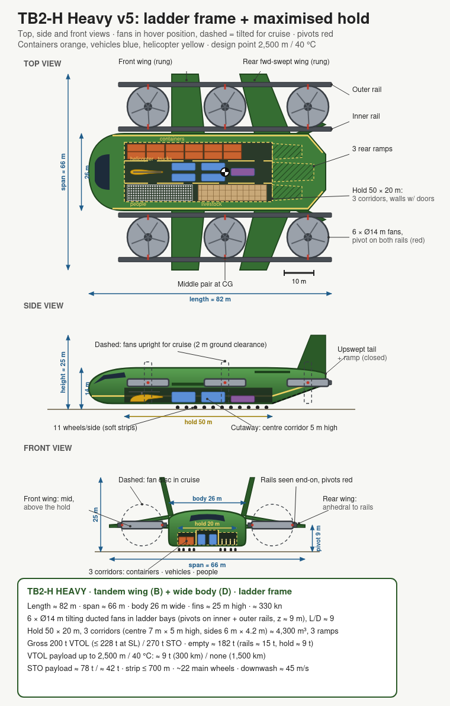

# tb2-derived

Designs inspired by Thunderbird 2 from *Thunderbirds* (1965), referred to here as **TB2**, playing "what if" scenarios:
what would it take to make TB2 a physically plausible heavy-lift VTOL rescue transport?



## Where it stands
One design, sized with first-order models (rough numbers, not engineering data).
A faster second variant (TB2-F) was dropped: existing aircraft such as the A400M
already cover it (notes §19).

| | TB2-H Heavy |
|---|---|
| Layout | Tandem wing + wide blended body |
| Lift | 6 × Ø14 m tilting ducted fans in a ladder frame |
| Gross VTOL | 200 t at 2,500 m / 40 °C (≈ 228 t at sea level) |
| Gross STO | 270 t (structural limit) |
| Empty | ~182 t, so VTOL leaves ~18 t for fuel + payload |
| Cruise | ~330 kn |
| Hold | 50 × 20 m, 3 corridors (vehicles, small helicopters, livestock, people) |
| VTOL payload up to 2,500 m / 40 °C (300 km shuttle) | ~9 t (open decision D10) |
| STO payload (300 / 1,500 km) | ~78 t / ~42 t |
| Strip needed (planning) | ≤ 700 m |

Key choices: lifting-body hull, canard / tandem surfaces bracketing the CG,
6 fans so a fan failure in hover is survivable, carbon-composite structure,
rear ramps instead of the pod, a maximised hold with corridor walls, design point 2,500 m / 40 °C (Africa incl. highlands,
with a global-warming margin).

## Files
| File | What |
|---|---|
| [`th-2-re-design-ideas.md`](th-2-re-design-ideas.md) | All design notes. **§0 = current status, decisions, open questions**; §1 onwards = history |
| [`th-2-conversation-log.md`](th-2-conversation-log.md) | Condensed log of the design discussion |
| `th-2-heavy.svg/.png` | Current drawing (v5): TB2-H Heavy, top + side + front views with dimensions, ladder-frame fans, maximised hold |
| `th-2-wing-options.svg/.png` | Lift-area options A–D |
| `th-2-fan-tilt.svg/.png` | How the fans tilt; mounting options; Heavy ladder-frame proposal |
| `th-2-re-design*.svg/.png`, `th-2-variants-v1/v2/v3/v4.*` | Earlier iterations |
| `th-2-sizing.py` | Weight / payload sizing model (fans, hot-and-high, STO) |
| `th-2-strip.py` | Take-off / landing strip-length simulation |

## Running the models
Plain Python 3, no dependencies:

```sh
python3 th-2-sizing.py   # weight breakdown + payload per climate condition
python3 th-2-strip.py    # take-off / landing distances per condition
```

Edit `VARIANTS` in `th-2-sizing.py` to try other configurations; `th-2-strip.py`
imports the same variants, physics and margins.

## Disclaimer
Non-commercial fan / engineering study. Not affiliated with or endorsed by the
rights holders. *Thunderbirds* and Thunderbird 2 are created by Gerry and Sylvia
Anderson; the series and its trademarks belong to their respective owners
(currently ITV Studios).
